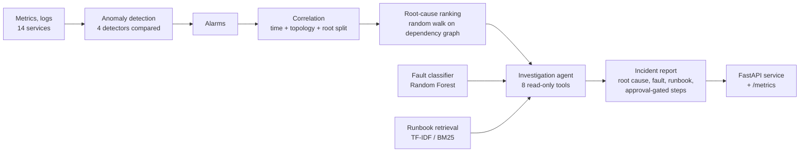

# AIOps Incident Copilot

[](https://github.com/AroneBenedict/aiops-incident-copilot/actions/workflows/ci.yml)

Detects anomalies in service telemetry, groups the resulting alarms into incidents, finds the
root-cause service, names the fault, and hands the on-call engineer a report that cites the
right runbook. A tool-calling agent runs the investigation; it can read everything and change
nothing.

The whole pipeline is evaluated against labelled ground truth, with a baseline for every
stage, over five random seeds.



## Results

Mean ± standard deviation over seeds 7, 11, 13, 17 and 19, on a held-out test period with 551
injected incidents in total. Thresholds and model choices were made on an earlier period that
the test numbers never touch. Full tables are in [`results/REPORT.md`](results/REPORT.md) and
the raw numbers in [`results/metrics.json`](results/metrics.json).

| Stage | Baseline | This project |
|---|---|---|
| Anomaly detection, point-wise F1 | 43.8% ± 2.2% (rolling z-score) | **82.5% ± 1.1%** (seasonal residual) |
| Alarm correlation, adjusted Rand index | 78.2% ± 3.4% (time window only) | **92.3% ± 1.8%** (time + topology + root split) |
| Root cause, top-1 accuracy | 86.6% ± 2.8% (earliest alarm) | **91.0% ± 2.1%** (random walk), top-3 98.7% |
| Fault type, accuracy over 8 classes | 60.2% ± 4.4% (service-kind lookup) | **87.9% ± 1.7%** (Random Forest) |
| Runbook retrieval, Hit@1 on 32 paraphrased queries | n/a | 81.2% (Hit@3 96.9%) |
| Agent: root cause, fault type and runbook all correct | n/a | **90.5% ± 1.1%** of detected incidents, 87.2% ± 1.8% of all incidents |

Correlation also reduces 2,080 test alarms to 933 incidents (55% fewer items to triage).

### What the results say

- **The simplest good detector won.** A robust z-score against a per-service daily profile
  (82.5% F1) beat Isolation Forest (77.2%) and a PyTorch LSTM autoencoder (75.5%) on the same
  features. The deep model is kept in the comparison, not in the pipeline.
- **Correlation mattered more than ranking.** Before the root split, overlapping incidents on
  neighbouring services were merged into one group, and a group has only one top-ranked root.
  Adding the split raised random-walk top-1 from 76.0% to 91.0% and fully correct agent reports
  from 75.2% to 90.5% (`scripts/ablation_root_split.py`).
- **The agent degrades when logs are silent, but still works.** A quarter of incidents are
  simulated with no fault-specific log lines at the root. The agent then falls back to the
  metric classifier: 82.6% fully correct, against 93.0% when logs are present.
- **The confidence label is only partly useful.** Reports marked "low" are right 81.5% of the
  time; "high" (91.8%) and "medium" (91.3%) are indistinguishable. It separates weak cases
  from the rest and nothing more.

## Quickstart

```bash
pip install -e ".[dev]"            # core + test tools (Python 3.10+)
pip install torch                  # optional: enables the LSTM autoencoder detector
pytest --cov                       # 83 tests
python -m aiops.pipeline --small --seeds 7        # a few seconds
python -m aiops.pipeline --seeds 7 11 13 17 19    # full evaluation, about 2 minutes
uvicorn aiops.api:app --port 8000
```

```bash
curl "localhost:8000/incidents?limit=3&min_services=2"
curl -X POST localhost:8000/incidents/34/investigate
curl localhost:8000/metrics
```

An investigation returns JSON and a Markdown report such as:

```text
# Incident 34: queue_backlog

- Status: complete (planner: rule, 7 tool calls)
- Affected services: message-queue, notifications, orders
- Root cause: message-queue
- Runbook: queue-backlog
- Confidence: high

message-queue is the most likely root cause. Its metrics moved: latency_ms +14.0σ,
error_rate +3.2σ, throughput_rps -3.9σ. The metric classifier says queue_backlog (84%);
the best runbook match is 'Message queue backlog and consumer lag'. Diagnosis rests on
log evidence.

## Proposed remediation
1. Check consumer group membership and the lag per partition.
2. Scale the consumer group out by adding consumers. [needs approval]
3. Move the poison message to the dead-letter queue. [needs approval]
```

## How each stage works

| Stage | Module | Method |
|---|---|---|
| Data | `simulate.py` | 14 services in a dependency graph, per-minute latency, error rate, CPU and throughput, with daily and weekly seasonality. Eight fault types are injected at a root service and propagate to its callers with delay, attenuation and drop-outs. |
| Features | `features.py` | Log-scaled metrics, robust z-score against a per-service minute-of-day profile, 5 and 15 minute trailing means. All causal. |
| Detection | `detect.py`, `detect_lstm.py` | Rolling z-score, seasonal residual, Isolation Forest, LSTM autoencoder behind one interface. Threshold chosen for best F1 on the history period. |
| Correlation | `correlate.py` | Alarms close in time on adjacent services are joined; a group with two independent root candidates is split. |
| Root cause | `rca.py` | Personalised PageRank over the alarmed subgraph, walking from callers to dependencies. |
| Fault type | `faults.py` | Random Forest on the metric signature at the suspected root. |
| Retrieval | `retrieval.py` | Runbooks chunked by section; TF-IDF and BM25 behind one `search` interface. |
| Agent | `agent.py`, `llm.py` | Bounded tool-calling loop with a pluggable planner. |
| Service | `api.py` | FastAPI endpoints plus Prometheus-format counters. |
| Evaluation | `evaluate.py`, `pipeline.py`, `report.py`, `tracking.py` | Metrics against ground truth, multi-seed aggregation, Markdown report, JSONL run log. |

## The agent

The agent has eight tools: `get_incident`, `rank_root_cause`, `get_metric_deviation`,
`fetch_logs`, `classify_fault`, `search_runbooks`, `get_remediation` and `submit_report`.

A planner decides which tool to call next. Two planners share one interface:

- **`RulePlanner`** is deterministic and offline. It still branches on what it sees: on a
  near-tie in the ranking it reads both candidates' logs; if its chosen root only logs
  complaints about a dependency it reads the next candidates and may switch; with no usable
  logs it falls back to the classifier and searches the runbooks again. All reported numbers
  use this planner.
- **`ClaudePlanner`** sends the same tools to Claude through the Messages API and lets the
  model choose. Set `AIOPS_PLANNER=claude` and `ANTHROPIC_API_KEY`. It is covered by tests
  against a fake client (tool results by id, error recovery, parallel calls, step limit). It
  has not been benchmarked against the live API, so no accuracy is claimed for it.

Guardrails that hold for both planners:

- Every tool is read-only. The agent proposes remediation; it cannot execute it.
- Approval flags come from the runbook, not the planner, so a model cannot waive them.
- Calls are validated against each tool's schema. Unknown tools, wrong types, a root cause
  outside the incident or an invented runbook come back as error observations.
- The loop stops at 12 steps and records every call in a trace.

## Engineering

- **Tests:** 83 unit and integration tests, 98% line coverage. They include reproducibility
  (same seed, same numbers), causality of features, and adversarial planners.
- **CI:** GitHub Actions runs lint, the tests with a 90% coverage gate and a pipeline smoke
  run on Python 3.11 and 3.13, then builds the container image.
- **Experiment tracking:** every pipeline run appends its config, seeds and results to
  `results/runs.jsonl`.
- **Observability:** `/metrics` exposes request counts, latency, investigations and tool
  calls by outcome.

Design notes and the defects found along the way are in [`docs/DESIGN.md`](docs/DESIGN.md).

## Limitations

- **The data is synthetic.** The simulator is built to be awkward (noisy services, unlabelled
  traffic bursts, mild faults, overlapping incidents, silent roots), but the simulator and
  the methods were designed together. The numbers show the pipeline works as designed and how the
  stages compare. They do not predict accuracy on a real estate.
- **Log-based retrieval is easy here.** Log lines come from a small set of templates, so when
  the root is right and it logged its fault, the runbook match is close to certain. The
  paraphrased-query test (81.2% Hit@1) is the fairer measure, and it is lexical only: a dense
  embedding retriever is the obvious next step.
- **The victim-phrase filter is hand-written** for this simulator's log formats.
- **Faults always flow from a dependency to its callers.** Two overlapping faults where one
  root depends on the other cannot be separated by the root split.
- **A false alarm on a dependency can be blamed** as the root of a real incident upstream.
- **The container image is built in CI but not deployed anywhere.** There is no hosted
  instance of the service.

## How this was built

This project was built AI-first, with Claude as a coding assistant for design iteration,
code, tests and documentation.

## Layout

```
src/aiops/      pipeline, agent and service
runbooks/       12 operations runbooks (8 fault types, 4 distractors)
data/           paraphrased retrieval queries
tests/          83 tests
scripts/        ablation
results/        metrics.json, REPORT.md, runs.jsonl
docs/           design notes
```
